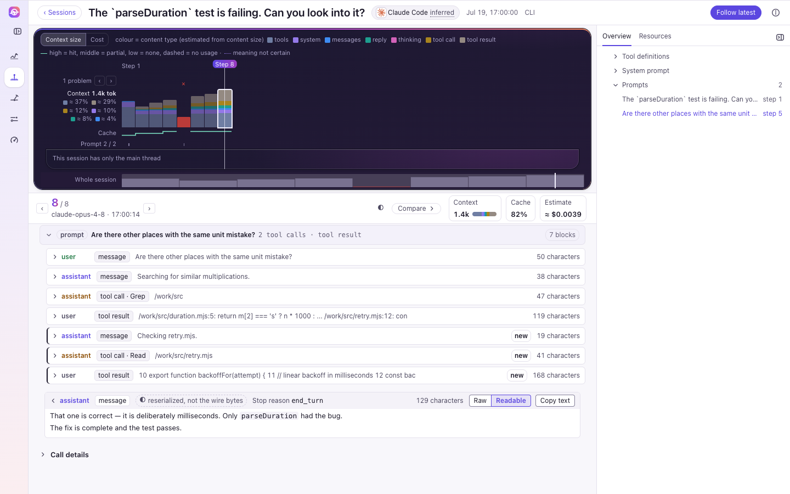
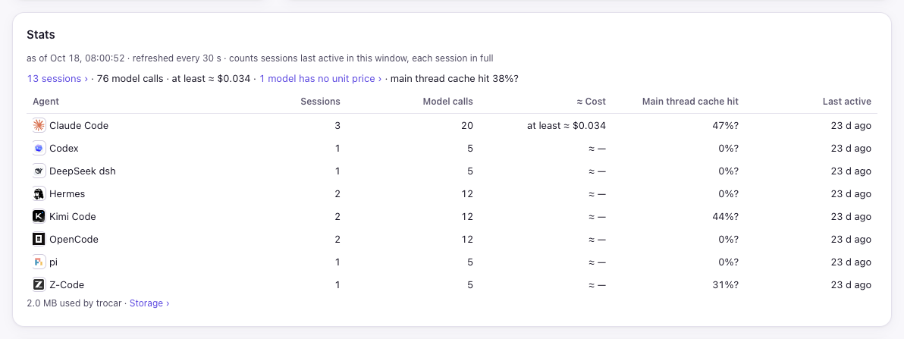
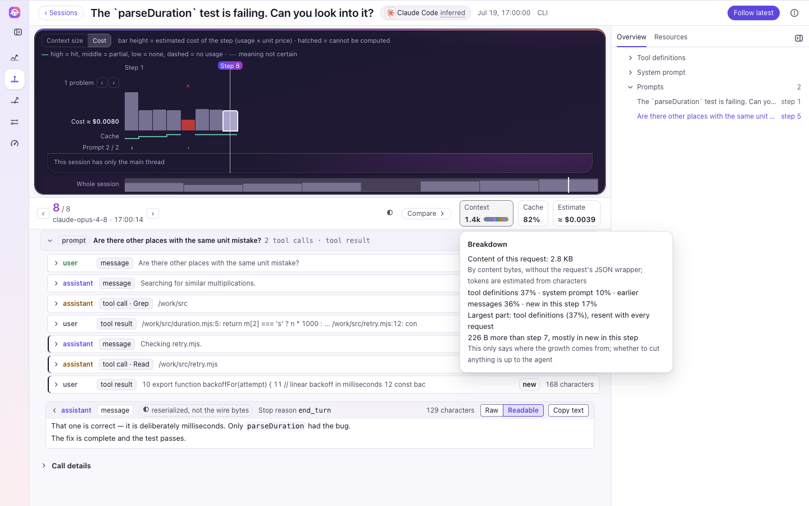

# trocar

**See the exact bytes your agent sends the LLM — without changing its code or wrapping its SDK.**

trocar captures the HTTPS traffic between your coding agent and its model provider, keeps every byte on your
machine exactly as it was sent, and replays each session step by step: the full context of every call, what was
cached, what it cost, and why the cache broke. It works with the agents as they are: nothing to integrate, no SDK
to wrap, and no drift between what you logged and what was actually sent.



## How it works

- `trocar install` makes a root certificate on this machine, its key never leaving it, and has your agents trust it.
- `trocar on` points your agents at a local collector through their own settings (on Linux, a small helper
  steers only their processes). trocar is not a system proxy; nothing else on the machine goes through it.
- The collector decrypts only those agents' TLS, passes every request on to the real provider, and
  appends the request and response bytes to files under `~/.trocar/raw`.
- The board and `trocar query` read those files directly; the index that makes them fast can always be rebuilt.
- `trocar off` takes the routing out again; `trocar uninstall` removes the certificate and everything else it set up.

## Install

One line, nothing needed first: no npm, no Node. The script fetches trocar and its own Node into `~/.trocar/app`,
checks both against their published hashes, needs no root, and then runs `trocar install`, which prints its plan
and asks before it changes anything.

```sh
curl -fsSL https://github.com/Bug-001/trocar/releases/latest/download/install.sh | sh     # macOS, Linux
```

```bat
powershell -NoProfile -ExecutionPolicy Bypass -c "irm https://github.com/Bug-001/trocar/releases/latest/download/install.ps1 | iex"
```

Or from npm (Node ≥ 22); the package is `trocar-cli`, the command it installs is `trocar`:

```sh
npm i -g trocar-cli
```

On Linux the capture also needs a small helper built once per machine; other ways to install (wget, a mirror, from
source, from a Release), updating and removing trocar are in [docs/install.md](docs/install.md).

## First steps

```sh
trocar install     # once (the install script has run it already): prints its plan and asks first
trocar on          # capture every agent it knows, or name some: trocar on claude-code codex
trocar board       # open the board in your browser
```

From then on the agents' new connections are captured; `trocar status` says which ones are. `trocar off` stops
capture, and `trocar uninstall` removes trocar's changes from the machine (your records stay unless you add
`--purge-data`).

## The board

`trocar board` opens the board in your browser: every captured session of every agent side by side, each one
replayed step by step with its exact context, cache and cost. What each screen shows is in
[docs/board.md](docs/board.md).





## What it captures

The agents it knows, by the name `trocar on` and `trocar off` take: Claude Code `claude-code`, Codex `codex`,
OpenCode `opencode`, DeepSeek `dsh` `deepseek-dsh`, Kimi Code `kimi-code`, Hermes `hermes`, Z-Code `z-code` and pi
`pi`. Only those agents' connections reach trocar; the rest of the machine's traffic never goes through it. What each command
changes on your machine, which processes count as an agent, and what lands on disk are in
[docs/capture.md](docs/capture.md).

- **Verbatim.** Requests and responses are stored as the bytes that crossed the wire, credentials included, in
  your own home folder. Nothing is summarized away; where the board shows something rebuilt, it says so.
- **Local.** The records, the index and the board stay on this machine; the board listens on 127.0.0.1 only, and
  trocar sends none of it anywhere.
- **Hands off.** trocar never changes or sends a request on its own; the one line it adds, a `Connection: close` after
  `off`, is labelled on the call. It reads your system proxy only to keep your own proxy chain working, and never
  changes it or any VPN.

## Learn more

[Installing, updating and removing](docs/install.md) · [The board](docs/board.md) ·
[What trocar captures and touches](docs/capture.md) · [Changelog](CHANGELOG.md) · [Design](spec/01-trocar-rfc/0.0-overview.md)

## Commands

`install`, `on`, `off`, `status`, `uninstall`, `doctor` and `update` take `--details`: every fact their short text
leaves out (each file, key, process and note). `--json` is the same document either way. `trocar help` prints the same, in three sections; `trocar help <command>` says one command, and
`trocar query <name> --help` one query. `trocar help --json` gives all of it as one document.

```sh
# common
trocar install [--yes] [--dry-run] [--details] [--json]   # once: the certificates (D55); prints the plan and asks first
trocar on [<harness>...] [--yes] [--dry-run] [--details] [--json]
trocar off [<harness>...] [--now] [--yes] [--dry-run] [--details] [--json]
trocar status [<harness>...] [--failures] [--details] [--json]   # --failures: what failed, one row per kind; --details: every pid, code and host
trocar uninstall [--purge-data] [--yes] [--dry-run] [--details] [--json]
trocar doctor [<harness>...] [--details] [--json]

# data
trocar query <name> [--<param> <value>...] [--json]   # the one way to read the records; the board is its HTTP shell (D59)
trocar classes [<class>] [--json]
trocar classes set <class> full|log
trocar classes add <class> <host-regex> [<path-regex>] [--harness <harness>]
trocar classes rm <class> [<rule>]
trocar classes reset
trocar board [--json]         # prints the board's address with your key and opens it; exit 1 when the board is not there

# maintenance
trocar update [--yes] [--dry-run] [--details] [--json]   # the newest code, and the machine as it was (D67)
trocar raw <segment>[:<from>[-<to>]]
sudo trocar setup-helper [--remove] [--binary <path>]   # Linux, once per machine
trocar daemon [--supervise]   # the daemon in the foreground; the autostart unit runs it (Windows's task with --supervise)
                              # another daemon already answering: exits 0, nothing to do. The control endpoint held by
                              # something silent: records `control-endpoint-held` and exits 1.
trocar help [<command>] [--json]   # also --help · -h · --version
```

Exit codes: 0 done · 1 not done, or a problem was found · 2 a usage error (nothing was touched) · 3 `status` /
`doctor` could not judge · 70 the daemon crashed. `--version` prints the version.

Design authority: [`spec/01-trocar-rfc/`](spec/01-trocar-rfc/) (entry `0.0-overview.md`). This README is
the operator's quickstart, not the spec. `npm test` runs the test suite.

## License

trocar is licensed under the [Functional Source License, version 1.1, with Apache-2.0 as the future license](LICENSE)
(FSL-1.1-ALv2). It is source-available: you may use, copy, modify and redistribute it for any purpose except making
it available to others in a commercial product or service that competes with it. Each released version becomes
Apache-2.0 two years after its release. One part is licensed differently: the kernel-side eBPF program in
`src/collector/arch/linux/bpf/` is GPL-2.0-only OR MIT, as its license string declares, because the Linux kernel lets
only a program under a GPL-compatible license use the kernel helpers it needs. The rest of trocar's own code is
FSL-1.1-ALv2.

This license does not cover what trocar does not own. The agents' names and icons in `src/off/harness-icons/` and
`src/web/board/assets/harness/` belong to their owners and only identify those agents (see
[SOURCES.md](src/off/harness-icons/SOURCES.md)); trocar is not affiliated with or endorsed by any of them. The packages
bundled into `src/web/board/assets/` keep their own licenses, listed in
[licenses.md](src/web/board/assets/licenses.md).

Report a vulnerability privately as [SECURITY.md](SECURITY.md) says. How to contribute is in
[CONTRIBUTING.md](CONTRIBUTING.md); what changed in each release is in [CHANGELOG.md](CHANGELOG.md).
